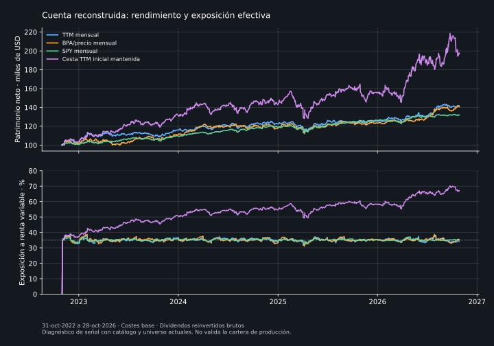

# Cuenta histórica de la señal TTM

Resultado del protocolo `reconstructed-ttm-account-v1`, publicado en
[`fb2b414`](https://github.com/Hardnyx/Trading/commit/fb2b41405d0a9ce5a24c1fa8710507043356348a)
antes de ejecutar el recorrido económico. Motor de referencia 0.35.0,
precios congelados al 28-oct-2026. Es el primer diagnóstico de una cuenta
sucesiva de la señal reconstruida; **no es el backtest de la cartera de
producción** y no acredita su ventaja económica.

## Resultado que importa

La regla mensual TTM termina con USD 141.298 frente a USD 140.657 al ordenar
solo por BPA/precio. La ventaja terminal de USD 642 sobre USD 100.000
iniciales **no tiene respaldo estadístico resuelto**. Su banda descriptiva
pareada admite ventaja y desventaja. El resultado concuerda con el estudio
de ranking: aún no se demuestra que los supuestos adicionales aporten
valor frente a la referencia simple.

Mantener la primera cesta termina con más patrimonio, pero su exposición
accionaria media aumenta a 53,5% y llega a 70,3%; la cuenta mensual conserva
aproximadamente 35%. También concentra hasta 38,6% del patrimonio en una
sola acción. No se atribuye toda su ventaja a evitar operaciones ni se
declara que mantener sea la estrategia correcta. Toma un riesgo diferente.

## Recorrido completo y costes

Las seis cuentas empiezan con USD 100.000 al 31-oct-2022. Se fijan 47
decisiones mensuales y se ejecutan desde el 2-nov-2022, dos sesiones SPY
después del primer origen. Se valoran diariamente hasta el 28-oct-2026.
Las doce cuentas (seis reglas por dos niveles de costes) terminan sin
precios ausentes en sus posiciones. Eso no certifica ausencia de empresas
desaparecidas en el universo actual.

Las reglas mensuales asignan 35% a renta variable y 65% a efectivo sin
remuneración: cinco acciones al 7%, o SPY al 35%. Es una manga de prueba
fijada antes del resultado, no una propuesta de inversión. Cada cuenta
conserva unidades, efectivo y costes; no se reinicia el capital al revisar.

| Cuenta, costes base | Patrimonio final USD | Retorno neto acumulado | CAGR por sesiones | Máxima caída diaria | Costes USD |
|---|---:|---:|---:|---:|---:|
| TTM mensual | 141.298 | 41,30% | 9,09% | 9,64% | 406,48 |
| BPA/precio mensual | 140.657 | 40,66% | 8,97% | 8,88% | 438,35 |
| SPY mensual | 132.173 | 32,17% | 7,27% | 6,82% | 33,47 |
| Primera cesta TTM mantenida | 197.360 | 97,36% | 18,67% | 18,42% | 15,75 |
| SPY inicial mantenido | 140.924 | 40,92% | 9,02% | 8,93% | 15,75 |
| Efectivo | 100.000 | 0,00% | 0,00% | 0,00% | 0,00 |

Los dividendos están reinvertidos brutos mediante el índice ajustado del
proveedor, sin sumarlos otra vez. No se reproduce su pago a caja, retención
fiscal ni los lotes/ejecuciones de una cuenta real. No hay venta final
ficticia para cerrar el informe. Los costes se financian dentro de la
cuenta usando el `tradePlan` de producción: spread completo 5 pb y slippage
2 pb, es decir, 4,5 pb por nominal comprado o vendido.

Con costes triples, TTM termina en USD 140.337 y BPA/precio en USD 139.622.
La ventaja terminal entre ambos sigue siendo pequeña (USD 715) y sin
superioridad resuelta. No se elige un nivel de costes por conveniencia.



## Incertidumbre y periodos

Se comparan 47 meses completos, noviembre de 2022 a septiembre de 2026.
Octubre de 2026 es parcial: está en el patrimonio terminal, pero no entra
en estas bandas. Por ello el estadístico anualizado de meses completos
**no es** la diferencia de CAGR ni la diferencia terminal de la tabla.

| TTM mensual frente a | Diferencia media logarítmica anualizada | Banda descriptiva por bloques de doce meses |
|---|---:|---|
| BPA/precio mensual | 0,82 puntos | [−5,18; 1,87] puntos |
| Primera cesta TTM mantenida | −10,55 puntos | [−13,31; −2,63] puntos |
| SPY mensual | 1,66 puntos | [−3,17; 2,06] puntos |

Se conservan 2.000 remuestreos con semilla fijada. La muestra contiene solo
tres bloques anuales completos sin solapamiento. Las bandas son
exploratorias por comparación, no un contraste formal corregido por
múltiples elecciones ni una certificación de cobertura con tan poca
historia. Tampoco eliminan sesgos del universo, catálogo y proveedor.

La cuenta TTM registra +3,20% en el tramo final de 2022, +12,20% en 2023,
+5,78% en 2024, +2,16% en 2025 y +12,91% hasta el 28-oct-2026. No cubre
2008, 2020 ni la mayor parte del ajuste de 2022. No basta para acreditar
comportamiento en crisis, ES o CVaR anual.

## Qué dice sobre los cambios de composición

TTM realiza 280 compras/ventas, con USD 406,48 de costes y diez revisiones
que reasignan al menos 10% del patrimonio, excluida la primera inversión.
El mayor cambio reasigna 22,11% al cierre del 4-mar-2025 con información del
28-feb: entran NVDA, PFE y VZ; salen DG, PCAR y UPS. Se conservan las señales,
fechas de informes, composiciones y operaciones para inspeccionar la causa.

Esta regla opera por ranking; **no ejecuta el optimizador robusto ni su
control frente a mantener**. Por tanto, sus cambios no se atribuyen a la
app ni prueban que una transición real hubiera sido autorizada. Permite
examinar el efecto económico de la señal antes de justificar ese salto.

## Límites y siguiente bloqueo

El universo y los supuestos de crecimiento/múltiplo son actuales. Los TTM
se filtran por presentación anterior al origen y se reutiliza la valoración
de producción, pero no hay vintages originales o universo histórico
verificados. Se heredan 226 exclusiones acción-origen por ajustes futuros
no conciliados y 141 por señal/exposición inválida, además de las
exclusiones contables del paquete original. El filtro ex post de operaciones
corporativas introduce sesgo; no se oculta porque las cuentas terminen.

El siguiente paso hacia el motor completo exige reconstruir holdings
históricas del benchmark para la neutralización CAPM/IC, perfiles fechados
de bonos y ETF, calidad/confianza contable y vintages macro. El recorrido
actual no rellena esas entradas con valores de hoy. No se prueba aquí
GJR histórico, selección robusta o anclas absolutas del simulador.

La producción permanece en 0.35.0, núcleo 1.0.0 y cohorte prospectiva de
señales `8f9ae829a773397f8311d7b4a71ec86f13fa31cbed288331a39e6b469e9b8b21`.
No se cambian parámetros ni se promueve la regla de esta prueba.

## Reproducción

```sh
node --test tests/account-replay.test.mjs tests/ttm-account-backtest.test.mjs
node scripts/ttm_account_backtest.mjs
# Gráfico opcional; requiere Matplotlib.
python scripts/plot_account_backtest.py --output out/ttm-account-backtest.svg
```

El script recupera el mercado congelado mediante Git y verifica su hash
frente al paquete TTM. Requiere el historial de ese commit, no credenciales
ni nuevas descargas. `out/ttm-account-backtest.json` conserva NAV, pesos
diarios, unidades tras cada transición, órdenes, costes y datos utilizados.
`out/ttm-account-summary.json` resume el diagnóstico. Los hashes de entradas,
dependencias matemáticas, protocolo y resultado, y la versión de Node,
permiten reproducirlo. El resumen permanente está en
[`auditorias/ttm-account-summary-2026-10-29.json`](auditorias/ttm-account-summary-2026-10-29.json).

CI ejecuta el recorrido con las mismas entradas, sin tocar producción,
y conserva ambos JSON durante 90 días. Las pruebas cubren aislamiento del
futuro, continuidad de la cuenta, presupuesto de costes, ejecución causal,
datos ausentes, reinversión sin duplicar dividendos y comparaciones pareadas.
Que pasen acredita esos controles de software, no capacidad predictiva.

Comprobación de esta entrega: 298 tests JS, 158 Python y `npm run check`
aprobados. Una conciliación independiente revisó 12.024 valoraciones
diarias, cobros/pagos de cada transición y suma de pesos; el residuo máximo
de caja fue menor de USD 0,000001. El protocolo publicado permanece idéntico.
