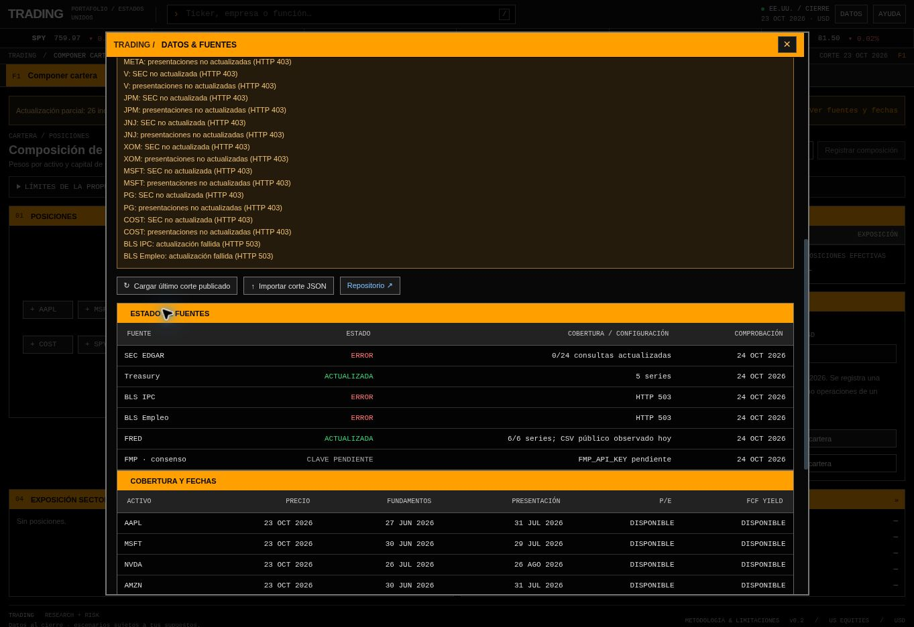

# Criterios de interfaz

Herramienta personal para componer una cartera con los datos del corte disponible y revisar después diferencias relevantes. La prioridad visual es una terminal financiera: datos densos, paneles rectos, navegación por funciones y tablas.

## Flujo

1. Proponer una cartera ex ante o seleccionar manualmente activos, capital y pesos.
2. Revisar fundamentos, valoración y proyecciones.
3. Registrar una composición con su corte de precios y fundamentos.
4. Cargar cortes posteriores y revisar cambios de peso, resultados, valoración y riesgo.
5. Marcar revisiones atendidas o registrar una nueva composición.

## Decisiones aplicadas

| Criterio                     | Aplicación                                                                                              |
| ---------------------------- | ------------------------------------------------------------------------------------------------------- |
| Visibilidad del estado       | Fecha de corte, fecha del registro, estado de cálculo y avisos de datos ausentes.                       |
| Correspondencia con la tarea | Nombres financieros directos y separación entre composición, seguimiento, investigación y proyección.   |
| Consistencia                 | Mismas columnas, unidades, formatos y acciones para cada activo.                                        |
| Control                      | Supuestos editables, importación/exportación, cierre con Escape y registro explícito de la composición. |
| Prevención de errores        | Validación de archivos y pesos; el registro requiere una suma de 100%.                                  |
| Reconocimiento               | Funciones visibles F1–F8, nombres de activos, enlaces a las fuentes y motivos de cada revisión.         |
| Eficiencia                   | Búsqueda con `/`, atajos por función y simulación en un Web Worker.                                     |
| Legibilidad                  | Números tabulares, alineación decimal, signos explícitos y colores de uso estable.                      |
| Densidad                     | Resúmenes en una fila, comparaciones en tablas; sin gráficos de dona ni bloques promocionales.          |

## Color

- Naranja: encabezados, función activa y supuestos del modelo.
- Azul: acciones y enlaces a activos/documentos.
- Verde y rojo: dirección de cambios o resultados. Las cifras llevan signos o etiquetas; el color no es el único indicador.
- Gris: estructura, información secundaria y valores de referencia.

Contrastes calculados para la paleta principal sobre `#080808`: texto `#dedede`, 14.89:1; texto secundario `#ababab`, 8.72:1; enlaces `#82c3ff`, 10.68:1; verde, 10.23:1; rojo, 7.58:1. Negro sobre el naranja de encabezado: 10.21:1.

Superficies y bordes usan una escala neutra (`--panel`, `--surface`, `--raised`; `--line-soft`, `--line`, `--line-strong`). Los paneles tienen encabezado oscuro con título naranja; el naranja sólido se reserva para la función activa, la acción principal y la línea superior de las métricas.

## Tipografía y espaciado

- IBM Plex Sans para interfaz y textos explicativos; IBM Plex Mono para cifras, etiquetas, tablas y códigos. Ambas se sirven desde `dist/assets/fonts` (SIL Open Font License), sin depender de fuentes del sistema ni de servicios externos.
- Escala de tamaños: 10, 11, 12, 14, 18, 24 y 32 px (`--fs-xs` a `--fs-3xl`). No se usan tamaños menores de 10 px.
- Espaciado en múltiplos de 4 px. Los paneles tienen un relleno interior de 12 px y una separación de 12 px entre ellos. Controles y botones miden 28 px de alto.

Se incluyen foco visible, etiquetas de campos, enlace para saltar al contenido, navegación por teclado y diálogos con control del foco. Las tablas conservan sus columnas y permiten desplazamiento horizontal en pantallas estrechas. No se afirma una auditoría integral de conformidad WCAG.

## Referencias

- [Nielsen Norman Group: 10 Usability Heuristics](https://www.nngroup.com/articles/ten-usability-heuristics/).
- [W3C: WCAG 2.2](https://www.w3.org/TR/WCAG22/).
- [W3C: contraste mínimo](https://www.w3.org/WAI/WCAG22/Understanding/contrast-minimum.html).
- [W3C: referencia rápida de accesibilidad](https://www.w3.org/WAI/WCAG22/quickref/).

La referencia visual es Bloomberg Terminal. El proyecto tiene identidad propia y no utiliza sus datos, logotipos ni software.

## Estado de las fuentes

El panel distingue una descarga correcta, una descarga fallida y una fuente pendiente de configuración. Las fechas de precios y fundamentos se mantienen visibles aunque una fuente no se actualice.

Captura de verificación del 24 de octubre de 2026:

## Mandato y decisiones

F8 concentra restricciones, cuenta y ejecución; F5 conserva las hipótesis y la evidencia por emisor; F2 muestra revisiones y evaluación prospectiva. Los campos se rotulan con moneda, plazo y unidad. Las cantidades ingresadas, las referencias teóricas y las órdenes propuestas tienen contextos explícitos. Registrar una referencia no confirma una operación.

Los resultados muestran costos netos, alternativas comparables y datos faltantes. Una tesis contradicha requiere revisión. El diario diferencia pendientes, retrospectivos y casos sin realización comparable. La incertidumbre asumida se distingue de la precisión medida.
